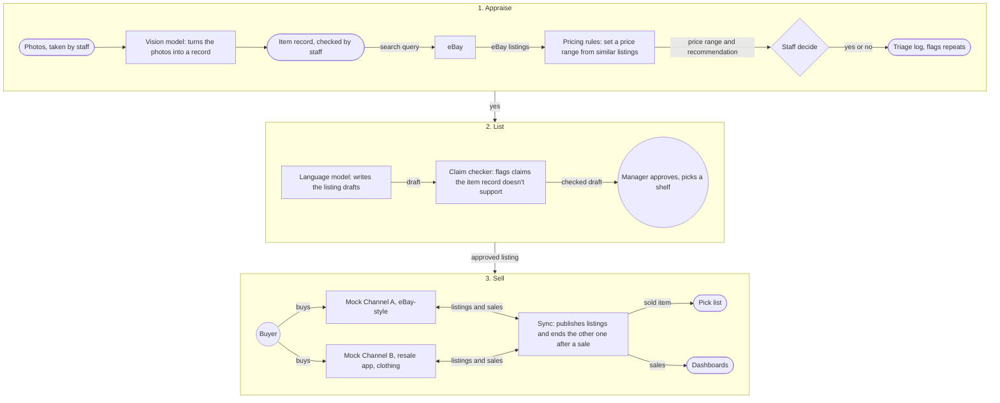
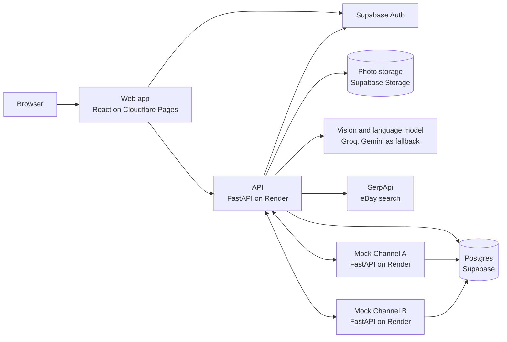

# Turnstone

**An AI-assisted path from donation to online sale.**
Turnstone is an app that streamlines pricing, listing and inventory sync for nonprofit thrift stores, built for Blessings Abound in Kansas City at Hack-A-Roo 2026.

- Hosted demo: https://blessings-abound.pages.dev
- Repository: https://github.com/KyleNaluan/blessings-abound

A turnstone is a shorebird that flips stones to find food, the way our app turns over donations to find what's worth selling online.

## Contents

The first half of this page is the project as the team presented it on its poster.
The second half is how to set the project up, run it and reproduce its results.

- [Overview](#overview): [introduction](#introduction), [objective](#our-objective), [problems and solutions](#problems-and-solutions), [how Turnstone works](#how-turnstone-works), [data](#data), [methodology](#methodology), [results](#results), [limitations](#limitations), [conclusions and future work](#conclusions-and-future-work), [team](#team-and-acknowledgements)
- [Poster and demo video](#poster-and-demo-video)
- [Reproducing the results](#reproducing-the-results): [repository layout](#repository-layout), [system architecture](#system-architecture), [prerequisites](#prerequisites-and-dependencies), [environment](#environment-setup), [setup](#setup), [offline demo](#offline-demo), [data sources](#data-sources-and-datasets), [preprocessing](#data-preprocessing), [analytics workflow](#analytics-workflow), [evaluation](#evaluation-procedures-and-results), [sample outputs](#visualizations-and-sample-outputs), [tests and lint](#tests-and-lint)
- [Contributing](#contributing)

## Overview

### Introduction

Blessings Abound is a nonprofit thrift store chain in the Kansas City area that receives over 2 million donated items a year.
As staff sort donations, they set aside items that could sell for more online and send them to the store's Ecommerce team to research and list.
Online sales are under 3% of total revenue.
Blessings Abound wants to grow them, but it hasn't yet found an efficient way to manage the work involved.

### Our objective

Build an AI-assisted app that helps staff take a donated item from intake to online sale with less repeated work and more reliable information, while people make every final decision.

### Problems and solutions

| Today | With Turnstone |
| --- | --- |
| **Repeated work.** Nothing marks an item as rejected, so it can come back and be researched again. | **Triage log.** Records each decision and warns when a rejected item returns. |
| **Inconsistent valuation.** Most items arrive with no information, and value is often judged from a quick Google Lens result. | **Item record and price.** Turns photos into a record, then suggests a price from similar eBay listings. |
| **Slow, high-stakes listings.** Research can take 15 minutes to days, and eBay penalizes incorrect details. | **Drafts and claim check.** AI writes a draft, and code flags claims the item's details don't support. |
| **Hard to sell on multiple sites.** Inventory was never centralized, and sold items stayed listed on other sites. | **Publish and sync.** Lists from one place, ends other listings after a sale and flags conflicts. |
| **Items are hard to track.** Items get a SKU only once listed, so unlisted items are hard to see. | **SKU, shelf and pick list.** Gives items a SKU at intake, a storage spot and a pick list entry when sold. |
| **Little sales insight.** The store wants to know what sells fastest and when, but has no log of this. | **Dashboards and chat.** Shows managers time to sell and seasonality, on synthetic data for now. |

### How Turnstone works

An item goes through three stages, and a person makes the call at each one.



The vision model and the language model are AI models, the pricing rules, claim checker and sync are Turnstone's own code, and the two channels are mock sales channels.

Turnstone is a staff web app that follows a donated item from intake to sale.
Every item forwarded to Ecommerce gets a SKU and a triage log entry at intake, and every item is one of a kind and sold online, unless a manager takes it out of online selling.
A staff member uploads a photo of an item and enters details such as condition and size, a vision model turns them into an editable item card, and the app looks up similar eBay listings to suggest a price range and whether the item is worth listing.
The price comes from code over those listings, never from the language model, which only explains the result.
Later stages draft the listing text, recommend a channel and timing, and send each listing to a manager for approval, along with its storage location and a pick list for when it sells.
Listings publish to two fictional mock channels that stay in sync after a sale, with conflicts flagged on a Needs Attention screen, and managers see sales insight on synthetic data.
Staff and managers make every final decision.

### Data

- **Photos:** openly licensed Wikimedia Commons photos, mostly clean studio shots, none from a thrift store.
- **Listings:** active eBay listings through SerpApi, cached for 7 days to stay inside the free plan.
- **Sold prices:** PriceCharting for games and hardware, and hand-recorded eBay or Mercari sales for apparel.
- **Labels:** a person checked all 48 item labels.
- **Sales history:** synthetic, calibrated to published figures.

[Data sources and datasets](#data-sources-and-datasets) says where each of these lives in the repository and how to regenerate it.

### Methodology

- **Stack:** React, Vite and Tailwind on Cloudflare Pages, and Python FastAPI on Render with Supabase Postgres.
- **AI models:** Groq's qwen model reads the photos into an item card, with Gemini as the fallback. The models also draft listings, but every price comes from code.
- **Mock channels:** two separate services stand in for real platforms, an eBay-style marketplace and a clothing resale app, and stay in sync after a sale.
- **Teamwork:** each task was a GitHub issue. On every pull request, a rules check looks for a linked issue and a full description, and CI runs lint, type checks and tests.
- **Price test:** we scored prices against sold prices on items fixed before their first run, and kept the tuning items apart.
- **Timed demo:** clicking from photo to decision took 71 seconds, and the full core run takes 2:45 with talking.

### Results

| Items | Turnstone | Asking prices |
| --- | --- | --- |
| Fresh games and hardware (30) | 21 of 30 in range, 19.7% median error | 14 of 30 in range, 31.2% median error |
| Apparel (26) | 12 of 26 in range, 35.0% median error | 13 of 26 in range, 34.2% median error |
| Tuning items (18) | 15 of 18 in range, 24.8% median error | 13 of 18 in range, 15.1% median error |

"In range" means the item's sold price fell between Turnstone's low and high price, and the median error is how far the typical price was from the sold price.
"Asking prices" is the baseline of raw eBay asking prices with no filter or adjustment.
The tuning items set the pricing rules, so their score is not the result, and the fresh items are.

- **Reading items:** the vision model named the brand on 44 of 48 photos and the product on 38 of 48.
- **Listing drafts:** 46 of 48 passed the claim checker.

These are small sets, so one or two items can move each number.
[Evaluation procedures and results](#evaluation-procedures-and-results) shows how to reproduce each number.

### Limitations

- **Proof of concept:** based on the challenges Blessings Abound shared. The store isn't using it.
- **No store data:** we had no access to its existing data, so the sales history is synthetic.
- **Mock channels:** fictional channels stand in for real platforms.
- **Asking prices:** comparisons are active eBay prices, adjusted by an estimated factor.

The thresholds, such as the $30 worth-listing bar, come from a short Q&A with Blessings Abound, and the project otherwise uses only public or self-generated data.

### Conclusions and future work

- Our pricing rules beat raw eBay asking prices on fresh games and hardware.
- Apparel pricing is about the same as the baseline.
- A person still needs to confirm what the AI reads.

Next, the team would:

- Connect to real sales platforms.
- Use the store's own sales data and database.
- Add other categories like books and decor.

### Team and acknowledgements

The team is Manan Koradiya, Kyle Naluan and Hallee Pham, at the University of Missouri - Kansas City.

- Project Pitchers: Humza Vora, John Wetzel
- Faculty Mentors: Roozmehr Safi, Yugyung Lee
- AI Mentor: Abhinav Kochar
- Blessings Abound: Mike Thomas (CEO), Rick (Ecommerce)

[WORKLOG.md](WORKLOG.md) logs what each developer changed.

## Poster and demo video

- Demo video: [Turnstone demo video](https://drive.google.com/file/d/1_noP9LFxwjQIpIpSxnfua10FyY4fDKTq/view?usp=sharing), 3:57 long on Google Drive, where anyone with the link can view it.
- Hosted demo: https://blessings-abound.pages.dev, with the API at https://blessings-abound-api.onrender.com.
- [docs/demo-script.md](docs/demo-script.md) is the script the team uses to show it, with the demo items, the fallback to the offline demo and the shot list for the demonstration video.

## Reproducing the results

Everything below runs from a fresh clone.
The [offline demo](#offline-demo), the [evaluation reports](#evaluation-procedures-and-results) and the [synthetic sales history](#synthetic-sales-history) need no keys and no paid service.
Only reading new photos with the vision model, running new eBay searches and signing in to a real Supabase project need keys, which are never committed.

### Repository layout

| Path | What it holds |
| --- | --- |
| `api/` | FastAPI backend, database models and Alembic migrations, with its dependencies in `pyproject.toml` and `uv.lock` |
| `api/app/` | The API's source, including the pricing pipeline, the evaluation scripts and the synthetic sales generator |
| `api/mock_channel/` | The two mock sales channels, run as their own services |
| `api/eval/` | The evaluation datasets: item lists with reference prices, vision labels, and the saved item cards, listing drafts and eBay responses the reports replay |
| `api/tests/` | The API's tests, with saved SerpApi responses in `tests/fixtures/serpapi/` |
| `web/` | Vite, React and TypeScript frontend with Tailwind and shadcn/ui, with its dependencies in `package.json` and `package-lock.json` |
| `docs/` | Requirements, architecture, the database, the evaluation reports, hosting and the demo script |
| `.env.example` | Every setting the app reads, with no values |
| `docker-compose.yml` | Postgres, the API and the two mock channels for local development |
| `docker-compose.offline.yml` | The offline demo, which adds a stand-in for every outside service |
| `.github/` | CI, the pull request rules check and the keep-alive ping |

The project has no notebooks.
Every analysis is a Python module in `api/app/` that rewrites its own report in `docs/`, so the report and the code that made it stay together.

### System architecture



Locally, `docker compose up` runs Postgres, the API and both channels on one machine, photos go to a local folder, and the web app runs with `npm run dev`.
[docs/architecture.md](docs/architecture.md) lists every technical choice and why it was made, describes each part of the app, and keeps the decisions log.
[docs/database.md](docs/database.md) describes every table.
[docs/operations.md](docs/operations.md) covers the hosted demo, keeping it awake and changing the API.

### Prerequisites and dependencies

- [Git](https://git-scm.com/downloads), which on Windows also gives you Git Bash
- [Docker](https://docs.docker.com/get-docker/) with Docker Compose, running before you start the setup (on Windows, open Docker Desktop and wait for it to say the engine is running)
- [Node.js](https://nodejs.org/) 24, the version in `web/.nvmrc`
- [uv](https://docs.astral.sh/uv/getting-started/installation/), which installs Python 3.12 itself

On Windows, run every command below in Git Bash, because Windows PowerShell 5.1 does not accept `&&` and Command Prompt has no `cp`.

Dependencies are pinned by the lock files, `api/uv.lock` and `web/package-lock.json`, and install with `uv sync` and `npm ci`.
The database is Postgres 17, from the `postgres:17-alpine` image in `docker-compose.yml`, the same major version as the hosted database.

### Environment setup

Every setting is in [.env.example](.env.example), with a comment on what it does and its default.
Copy it to `.env`, which git ignores, and fill in only what you need:

| What you want to run | Settings to fill in |
| --- | --- |
| The offline demo, the evaluation reports, the synthetic sales history and the tests | None |
| Signing in to the web app | `VITE_SUPABASE_URL` and `VITE_SUPABASE_ANON_KEY`, and for a username also `SUPABASE_URL`, `SUPABASE_ANON_KEY` and `SUPABASE_SERVICE_ROLE_KEY` |
| Reading photos into item cards, drafts and the sales chat | `AI_BASE_URL`, `AI_MODEL` and `AI_API_KEY`, and optionally the matching `AI_FALLBACK_` settings |
| Pricing with live eBay listings | `SERPAPI_API_KEY` |

Keys stay in `.env` and in the hosting dashboards, and never in the repository.

### Setup

Clone the repository and go into it:

```sh
git clone https://github.com/KyleNaluan/blessings-abound.git
cd blessings-abound
```

Run the database and the API in one terminal:

```sh
cp .env.example .env
docker compose up
```

The API applies database migrations on start and serves at http://localhost:8000, with interactive docs at http://localhost:8000/docs.

Run the web app in a second terminal:

```sh
cd web
npm ci
npm run dev
```

Open http://localhost:5173 for the landing page.
Signing in needs `VITE_SUPABASE_URL` and `VITE_SUPABASE_ANON_KEY` in `.env` and an account in that Supabase project.
An email address works with just those two, but a username also needs the API running with `SUPABASE_URL`, `SUPABASE_ANON_KEY` and `SUPABASE_SERVICE_ROLE_KEY` set.
The service role key stays on the server, and the web build stops with an error if it finds that key in a `VITE_` variable.
After signing in, each card on the home page at http://localhost:5173/app should show its count, or a line such as "No items to approve" when that list is empty.
If the API can't be reached, it says so above the cards.

The appraisal screen at http://localhost:5173/app/appraise also needs the API to check your sign-in and find your profile.
Set `SUPABASE_URL` and `SUPABASE_ANON_KEY` in `.env`, then give your Supabase Auth user a profile in the local database:

```sh
cd api
uv run python -m app.seed_local_profile <auth user id> <username> [staff|manager]
```

The Auth user id is on the user's row in the Supabase dashboard, and the script refuses any database that isn't local.

If port 5432, 8000, 8001 or 8002 is already taken on your machine, set `POSTGRES_PORT`, `API_PORT`, `CHANNEL_A_PORT` or `CHANNEL_B_PORT` in `.env`, and update `DATABASE_URL` or `VITE_API_URL` to match.

Without a Supabase project, use the [offline demo](#offline-demo) instead, which signs in with no keys.

### Offline demo

This runs the whole app on one laptop with no keys and no Wi-Fi, in case the venue's network or a hosted service fails.
It is also the quickest way to try the app from a fresh clone.
Build it once while you still have a network, because the images have to be downloaded and built:

```sh
docker compose -f docker-compose.yml -f docker-compose.offline.yml build
```

Then start it, with or without a network:

```sh
docker compose -f docker-compose.yml -f docker-compose.offline.yml up
```

Open http://localhost:5173 and sign in as `demo.staff` or `demo.manager`, both with the password `offline-demo`.
A small stand-in service in [api/app/offline_standin.py](api/app/offline_standin.py) answers for Supabase, the vision model and SerpApi, and the app's own code runs unchanged.
It doesn't read the photo, so every photo gets the same Levi's 501 card, and prices come from the saved eBay responses in `api/tests/fixtures/serpapi/`, chosen by the words in the search.
The addresses it uses are `localhost`, so it works only in a browser on the laptop running it, not from a phone.
The mock channels run as they do in `docker compose up`, so the steps in [Mock channels](#mock-channels) work offline too, with `demo.manager` as the manager who approves and stores the item.

Taking in any photo as `demo.staff`, with "Clothing and shoes" and "Pre-owned" as in the [demo script's core run](docs/demo-script.md#2-intake-025-total-045), and pressing "Confirm and get the price" always gives the same result, so it shows that the pipeline runs end to end:

| Shown | Offline value |
| --- | --- |
| Low, typical, high | $16.12, $19.34, $24.16 |
| Left after eBay fees and supplies | $14.81 |
| Listings the price comes from | 54, after 5 far from the rest were left out of 59 |
| Recommendation | Not worth listing, high confidence, because $14.81 is under the $30.00 bar |

[docs/demo-script.md](docs/demo-script.md#resetting-the-demo-data) shows how to reset the offline demo's data.

### Mock channels

`docker compose up` also starts the two mock sales channels, which [docs/architecture.md](docs/architecture.md#mock-channels-and-sync) describes.
Channel A, an eBay-style marketplace for clothing, electronics and games, has its storefront at http://localhost:8001, and Channel B, a resale app for clothing only, has its storefront at http://localhost:8002.

To see a sale come through:

1. Appraise an item in the web app, say yes to it, and send its listings on.
2. As a manager, approve it from the approvals page and enter its shelf or bin.
   Storing it lists it on each channel its drafts are for, at the price on the review page, and the review shows each listing go live within a few seconds.
   A game or a console goes on Channel A only, because Channel B takes clothing only.
3. Open either storefront and buy the item.
   It disappears from the other storefront within a few seconds, because the sale webhook tells the API at once, and the item shows on the pick list.
4. Untick "Tell the seller right away, by sale webhook" before buying to show a missed webhook, and the API's poll, every 30 seconds, finds the sale instead.

Each channel's `/admin` page, at http://localhost:8001/admin or http://localhost:8002/admin, takes the channel offline and back.
Sign in with any username and the channel key, which is `local-channel-a-key` or `local-channel-b-key` unless `.env` sets `CHANNEL_A_KEY` or `CHANNEL_B_KEY`.
While a channel is offline, the API's updates to it fail and are retried from the `jobs` table, with waits from 5 seconds up to 5 minutes, and go through once it is back.
A listing that still hasn't gone up after 10 tries shows on the review page with a button to try that channel again.
Buying the same item on the second channel before the first has taken it down is flagged as a double sale.
Every change and every flag is in the `sync_log` table, as [docs/database.md](docs/database.md#needs-attention-flags) describes.

To see a double sale fixed:

1. Store an item that goes on both channels, such as a piece of clothing with a brand.
2. Buy it on Channel A with "Tell the seller right away, by sale webhook" unticked, then buy it on Channel B within 30 seconds, before the poll finds the first sale.
3. Open "Needs attention" from the navigation bar, as staff or a manager.
   Press "Review" on the double sale, which says which order keeps the item and which one to cancel.
4. Press "Cancel the Channel B order".
   Channel B cancels the order, and the flag moves to "Recently handled" with who fixed it.

Take Channel B offline before step 4 to see the cancel retried, and it goes through once Channel B is back.

### Hosted demo

The hosted demo is at https://blessings-abound.pages.dev, with the API on Render, the database, photos and sign-in on Supabase, and the two mock channels on Render next to the API.
Accounts there are invite-only, as [docs/database.md](docs/database.md#accounts) describes.
[docs/operations.md](docs/operations.md) has every setting needed to host it again, how it is kept awake, and the checklist the team runs before judging.

### Data sources and datasets

No data from Blessings Abound is in the repository, and no seller names or other personal details are in the fixtures.

#### Synthetic sales history

The sales dashboards run on a synthetic history, because the store has no real one, and every chart drawn from it is labeled synthetic.
It comes from a model calibrated to published figures, with every parameter and its source listed in [docs/synthetic-sales.md](docs/synthetic-sales.md).
Load it into the database from `docker compose up` with:

```sh
cd api
uv run python -m app.synthetic_sales
```

It replaces the `synthetic_items` and `synthetic_listings` tables with about 600 items from the fixed seed, and the same seed always gives the same rows.
Add `--seed N` for a different history.
A manager sees the dashboards from the Dashboards link in the navigation bar, and a view with no history loaded says so instead of drawing an empty chart.
The Dashboards page also has an "Ask about sales" box, where the model picks one of a few tested functions to answer a question from and shows the call it used, see [Sales insight chat](docs/architecture.md#sales-insight-chat).
`uv run python -m app.synthetic_calibration` checks the model against the published figures it is calibrated to over 200 seeds and rewrites [docs/synthetic-sales.md](docs/synthetic-sales.md), which also lists every parameter and where it comes from.

#### eBay listings through SerpApi

Prices come from active eBay Buy It Now listings, fetched through SerpApi's eBay engine, because eBay's own API license does not allow using its content to suggest or model prices.
SerpApi's free plan allows 250 searches a month, so the app caches each response for 7 days and stops at `SERPAPI_MONTHLY_BUDGET`, 240 by default.
Every response the tests and the evaluation use is committed, in `api/tests/fixtures/serpapi/` and `api/eval/serpapi/`, with the `api_key` and the `seller` object removed.
[docs/serpapi-ebay-check.md](docs/serpapi-ebay-check.md) is the first check that these searches give usable prices, and it describes the fields the app reads.

#### Vision and language model

The vision and language model is any OpenAI-compatible endpoint, set by `AI_BASE_URL`, `AI_MODEL` and `AI_API_KEY`.
The team used Groq's qwen model with Gemini as the fallback, and the item cards and listing drafts it wrote for the evaluation items are saved in `api/eval/cards/` and `api/eval/drafts/`, each with the provider that answered.
The reports replay those saved answers, so they need no key and give the same numbers on every run.

#### Evaluation items, photos and reference prices

- `api/eval/items.json` holds the 18 tuning items and 30 apparel items, 26 of them scored, and `api/eval/fresh_items.json` holds the 30 fresh games and hardware items, each with its photo, its reference sold price and where that price came from.
- Reference prices for games and hardware come from PriceCharting, and for apparel they were read by hand from eBay's or Mercari's sold listings under a fixed rule, described in [docs/evaluation.md](docs/evaluation.md#apparel-reference-rule).
- `api/eval/vision_labels.json` holds the brand, category and product a person checked for each of the 48 games and hardware photos.
- The photos are openly licensed Wikimedia Commons photos, linked rather than copied into the repository, with each one's author and license in [docs/evaluation.md](docs/evaluation.md#photos-and-item-notes).
  The demo items' photos and their licenses are in [docs/demo-script.md](docs/demo-script.md#demo-items).

#### Store settings

The worth-listing bar, fees, ask-to-sale factors, seasonal calendar and box sizes start from published sources and the Q&A with the store, which [docs/settings.md](docs/settings.md) lists with each source.
The pricing rules' other numbers are in `PricingRules` in [api/app/settings.py](api/app/settings.py), each with its reason.

### Data preprocessing

Turnstone has no offline preprocessing step, because every input is cleaned as the app takes it in:

- **Photos:** a photo over 2,048 pixels or 4 MB is stored as an upright JPEG of that size, a code-only blur and brightness check prompts a retake, and each photo's SHA-256 hash catches a rejected item coming back, as [Photo check](docs/architecture.md#photo-check) describes.
- **Item cards:** the vision model's card is validated, any staff entry it sends back is dropped, and staff confirm a card with no brand or low confidence before a search is spent.
- **eBay listings:** code drops accessories, lots, parts, duplicates and listings that don't match the item's department, size type or completeness, then trims outliers with Tukey fences on log price, and each dropped listing keeps its reason.
- **Synthetic history:** generated from one seeded random stream, so it needs no cleaning.

### Analytics workflow

Turnstone trains no model.
It prices items from comparable eBay listings with code, so every price can be traced to the listings behind it, and the team chose this over a model trained on a sales dataset, as the [decisions log](docs/architecture.md#decisions-log) records.

1. **Item card:** the vision model turns the photos and staff entries into a card with the brand, product, a search query and its own confidence, and staff can edit it.
2. **Comps:** code searches eBay through SerpApi for the card's search query in the right condition, and drops a word and searches again when too few listings survive the filter.
3. **Price range:** code takes percentiles of the filtered asking prices, the 25th to 75th for apparel and the 15th to 85th for games and hardware, and multiplies them by an ask-to-sale factor, 0.645 for apparel and 0.94 for games and hardware.
4. **Recommendation:** code says "yes" when the typical sale price is at least $30, "no" below it, and "check" when confidence is low or there are no comps, and shows the net after eBay's fees and supplies beside it.
5. **Explanation:** the language model explains the numbers in 2 to 3 sentences, and code rejects the text if it contains a number that isn't in the facts it was given.
6. **Staff decide:** staff make the call, and a call against the recommendation needs a reason, which goes in the triage log.

[Pricing pipeline](docs/architecture.md#pricing-pipeline) describes each step in full.
It needs a SerpApi key in `SERPAPI_API_KEY`, and without one an appraisal saves a "check" with no price.
Tests never call SerpApi, because they read committed fixture responses instead and clear the key.
A manager can change the worth-listing price, the fees and the ask-to-sale factors on the Settings page, which is described with its sources in [docs/settings.md](docs/settings.md).

After a yes, the app recommends a channel and when to list ([Channel and timing recommendation](docs/architecture.md#channel-and-timing-recommendation)), drafts each listing and checks its claims ([Listing drafts](docs/architecture.md#listing-drafts)), and sends it to a manager.
A manager approves or rejects each item whose listings staff sent on, sets a price per channel, enters the package and the shelf or bin, and staff pull sold items from the pick list, as described in [docs/architecture.md](docs/architecture.md#manager-approval-and-storage).
Storing an approved item lists it on the mock channels, and a sale on either one puts it on the pick list, as [Mock channels](#mock-channels) shows.
The sales dashboards and the "Ask about sales" chat read the synthetic history, as [Sales dashboards](docs/architecture.md#sales-dashboards) describes.

### Evaluation procedures and results

Each evaluation is a script that replays committed inputs and rewrites its report, so anyone can run it again with no keys and get the same numbers.
Run each one in `api/` after `uv sync`:

| Command | Report | What it measures | Headline result |
| --- | --- | --- | --- |
| `uv run python -m app.evaluate` | [docs/evaluation.md](docs/evaluation.md) | Pricing against independent sold prices, and raw asking prices scored the same way as the baseline | Fresh games and hardware: 21 of 30 in range against the baseline's 14 |
| `uv run python -m app.vision_accuracy` | [docs/vision-accuracy.md](docs/vision-accuracy.md) | The vision model's brand, category and product against labels a person checked | Brand 44 of 48, product 38 of 48 |
| `uv run python -m app.draft_eval` | [docs/listing-drafts.md](docs/listing-drafts.md) | How often the model's own listing draft passes the claim checker | 46 of 48 pass |
| `uv run python -m app.synthetic_calibration` | [docs/synthetic-sales.md](docs/synthetic-sales.md) | The synthetic history against the published figures it is calibrated to, over 200 seeds, with one figure held out | Every calibrated measure within 25%, and the hold-out 29.0% low |

The pricing evaluation was set up so that its result can't be tuned to:

- The 18 tuning items set the ask-to-sale factor and the percentiles, and their score is reported apart from the result.
- The 30 fresh items were committed before their first score, which `git log -- api/eval/fresh_items.json` shows, and no rule changed after it.
- Apparel kept its first rules, and no rule was fit to the apparel items.
- An item is in range when its reference price falls between the low and the high, an item with no price counts as out of range, and error is the distance from the typical price to the reference, as a percent of the reference.

Each report's "Limits" section says what its numbers can't show.
A test fails whenever a committed report no longer matches what its script would write, so the reports in `docs/` always match the code.

New inputs need keys and spend searches or model calls:

- `uv run python -m app.evaluate --read-cards` asks the vision model for any missing card, and `--live-searches N` allows up to N new SerpApi searches. A saved card or search is never repeated, so deleting its file is how to redo one.
- `uv run python -m app.draft_eval --write-drafts` writes the drafts again with the AI keys.

[docs/serpapi-ebay-check.md](docs/serpapi-ebay-check.md) is a one-off check from before the pricing code existed, kept as the record of why the searches use the condition ids and title filter they do.
The timed demo's 71 seconds and 2:45 are in [docs/demo-script.md](docs/demo-script.md#what-was-measured).

### Visualizations and sample outputs

- **Dashboards:** a manager's Dashboards page shows time to sell, seasonality, the triage funnel, and sync health, each chart labeled as synthetic history or live test sales. Load the [synthetic sales history](#synthetic-sales-history) and sign in as `demo.manager` on the offline demo to see them.
- **Reports:** the four reports in the table above are the analysis outputs, with a row for every item, its search, its reference price and the pipeline's range.
- **Offline appraisal:** the [offline demo](#offline-demo) always prices the Levi's 501 card the same way, shown in its table.
- **API:** http://localhost:8000/docs lists every route with its request and response.

A saved item card, `api/eval/cards/levis-501.json`, is an example of what the vision model returns for a photo:

```json
{
  "provider": "api.groq.com/qwen/qwen3.8-27b",
  "card": {
    "category": "apparel",
    "brand": "Levi's",
    "product": "jeans",
    "visible_text": "LEVI STRAUS & CO.",
    "search_query": "Levi's vintage blue jeans",
    "model_confidence": "high",
    "color": "blue",
    "material": "denim",
    "exact_model": null,
    "platform": null
  }
}
```

In the pricing evaluation, the pipeline priced that card at $16.48 to $33.86 with a typical $24.19, which held the sold reference of $33.12 and came out as not worth listing.

### Tests and lint

Each part runs the same checks as CI.

API, with the database from `docker compose up` running:

```sh
cd api
uv sync
uv run ruff check . && uv run ruff format --check .
uv run pyright
uv run alembic upgrade head
uv run alembic check
uv run alembic heads
uv run pytest
```

`alembic heads` should print exactly one line.
The tests refuse to run against anything but a local database.

A change to the pricing rules, the comp filter or the evaluation items makes a test fail until `uv run python -m app.evaluate` in `api/` rewrites [docs/evaluation.md](docs/evaluation.md), which spends no searches and needs no keys.

A change to the saved cards, the vision labels or the item card prompt makes a test fail until `uv run python -m app.vision_accuracy` in `api/` rewrites [docs/vision-accuracy.md](docs/vision-accuracy.md), which makes no model calls and needs no keys.

A change to the listing prompt, the claim checker or the saved drafts makes a test fail until `uv run python -m app.draft_eval` in `api/` rewrites [docs/listing-drafts.md](docs/listing-drafts.md), which makes no model calls and needs no keys.
A prompt change also needs the drafts written again with `--write-drafts`, which uses the AI keys.

Web:

```sh
cd web
npm run lint && npm run format:check
npm run typecheck
npm test
npm run build
```

Pull request rules, from the repository root:

```sh
uv run --no-project --python 3.12 python -m unittest discover -s .github/scripts
```

These test the check that each pull request's commits and description follow [CONTRIBUTING.md](CONTRIBUTING.md), which CI runs with `.github/scripts/pr_rules.py`.
They run with the Python that uv installs, because the README asks for no Python of its own and `python3` on Windows is only a link to the Microsoft Store.

To run the formatters and linters before every commit, install the pre-commit hooks once with `uvx pre-commit install`.

## Contributing

Read [CONTRIBUTING.md](CONTRIBUTING.md) for the branch and review workflow and the project conventions.
See [docs/requirements.md](docs/requirements.md) for what the team is building, by tier, and the assumptions it rests on.
See [docs/operations.md](docs/operations.md#changing-the-api) for regenerating the web app's API client and changing the schema.
See [WORKLOG.md](WORKLOG.md) for a log of what each developer has changed.
